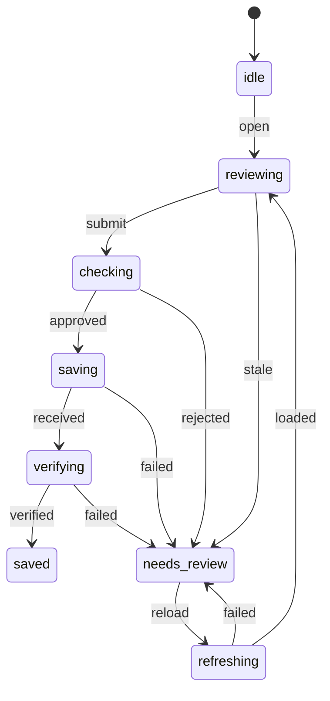

# Workflow states — November 11, 2026

This review covers the active workspace and notice studio, their first-party
scripts, the scoped task connector and related server contracts. The full source
map is [workflow-state-inventory.json](workflow-state-inventory.json): 25 workflow
families, with states, guards, source owners and regression tests. Historical
prototypes, pinned vendor internals and external applications are excluded.
The inventory describes source behavior, not verified live tenant/payment state.

## The decision

Keep independent workflows independent. Navigation, a local draft, a server save,
a sent message and a payment are different states. Task status, archive status,
personal EOD attribution and due date are separate axes. A renewal's progress
status is also separate from the lifecycle of writing its journal update.

Existing session epochs, preview tokens and idempotent task proposals already
guard many workflows. Preserve those protections. No framework, state library,
new dependency, database migration or new authorization path is needed here.

Use a small shared lifecycle for **task edits and renewal journal writes**, where
the source review found ambiguous save results, stale completion callbacks and
draft replacement during background reload. Other controllers remain as recorded
in the inventory; their conceptual labels are not new executable APIs.

## Reviewed writes



Closing, losing access, changing account or selecting another record resets the
controller to `idle` and invalidates its outstanding UI ticket. This does **not**
cancel or undo a request already sent to the server. Every asynchronous result
must still match its ticket, account and selected record before affecting the UI.

- **Task edits:** lock the reviewed fields during save/readback. Verify exactly
  one saved task, the receipt identity/version, all edited fields and its active
  state. Timestamp comparison preserves PostgreSQL microseconds. Only then close
  the editor. On uncertainty, retain the draft, block another submission and
  offer **Reload saved version**. Reload is an explicit draft-replacement action.
- **Renewal updates:** bind the preflight to the event version shown when the
  form was built. Independently read back the returned event identity, case,
  actor, summary and reviewed metadata. A background refresh preserves unsaved
  text; a newer event requires reloading/review. A late reply for case A cannot
  clear case B's draft or display a success message there.
- **Session boundaries:** clear private form values and related-record labels.
  An old request has no finalizer that can enable a newer session's Save button.
- **Stalled requests:** each request has a 20-second client wait. A timeout moves
  the write to review-required and aborts the client fetch; it does not establish
  server rollback. Late results cannot turn the uncertain outcome into success.

The machine is [reviewed-write-model.js](../reviewed-write-model.js); domain
readback rules live in [task-edit-model.js](../task-edit-model.js) and
[renewal-tracking-rules.js](../renewal-tracking-rules.js). Invalid transitions and
foreign/expired tickets return false. After uncertainty, another write is not a
legal transition until a reload and fresh review have completed.

## Developer and agent interface

Run these without credentials or a network connection:

```sh
node scripts/workflow-states.cjs --check
node scripts/workflow-states.cjs --json
node --test tests/reviewed-write-model.test.cjs
```

CI checks that every first-party script loaded by `index.html` or `generator.html`
has an inventory owner and that referenced sources/tests exist. New modules must
be mapped. The JSON command adds the executable shared transition table to the
inventory; it contains no current record IDs, labels, tokens or private data.

In a browser, `#today-edit-dialog` and `#ops-renewal-tracker` expose
`data-workflow-state`; their forms expose `aria-busy`. These are inspection hooks,
not authorization or task-completion evidence. A disabled button is explained by
the named phase and visible feedback rather than inferred from several flags.
Agents still use the scoped authenticated task API for routine task writes and
must follow its proposal/approval/readback contract. The UI lifecycle does not
grant access or replace server guards.

## Remaining work and boundaries

1. **Renewal journal concurrency:** its latest-event check followed by table POST
   is not an atomic server compare-and-append. Multiple staff can pass that check
   concurrently. A future bounded database/API change should add an expected
   prior-event check and stable retry identity inside one transaction. This UI
   change blocks blind retries after uncertainty; it does not invent server
   idempotency or claim to solve that race.
2. **Other async controllers:** retain their existing epoch, account, version and
   preview guards. Migrate only when a concrete defect or repeated behavior
   warrants it. Do not force guides, local PDF previews or business status values
   into the reviewed-write graph.
3. **Product gaps:** the full ten-page new-lease exporter and wider operational
   integrations remain unfinished. A rendered condition sheet, unsigned lease or
   prepared email is not an executed agreement or sent message.

Verification uses fictional browser records, model tests and CI's disposable
database checks. It does not exercise real staff accounts or actual sending,
signing, payments or Windows programs. The Supabase changelog HTTP request was
blocked by the runtime proxy; current session documentation was retrieved through
the documentation connector. No Supabase interface or session policy is changed.
